<div align="center">

# UniHub · 校园通

**一个 100% 原生 Kotlin、零 Layout XML 的校园生活 App**

课程表 · NFC 打卡 · 扫码直达 · 校园圈子 · 订阅会员


</div>

---

## 这是什么

UniHub 是一个校园生活类 App 的高保真实现。它先有一份纯 HTML/CSS 的交互原型（放在 [`design/`](design/)），再被逐屏、逐动效地翻译成**原生 Android 代码**。

与常见的「WebView 套壳」做法不同，这里的每一寸界面都是真实的 Android View：

- **没有一行 layout XML**——整棵 View 树在 Kotlin 里搭出来，尺寸、圆角、间距、阴影全部代码化
- **自定义 View 绘制**——开屏的墨色晕染、扫码框的往复扫描线、课表网格线都是 `onDraw` 画出来的
- **原生动效**——`ValueAnimator` + 三次贝塞尔缓动复刻原型的时间轴，不是 CSS transition 的近似
- **跟随系统的亮暗主题**——`values/` 与 `values-night/` 双份色板，切换后立即生效并持久化

共 **2 852 行 Kotlin / 11 个源文件**，无第三方 UI 库（除 Material Components 与 AppCompat）。

---

## 效果预览

<table>
  <tr>
    <td align="center"><b>开屏</b><br/>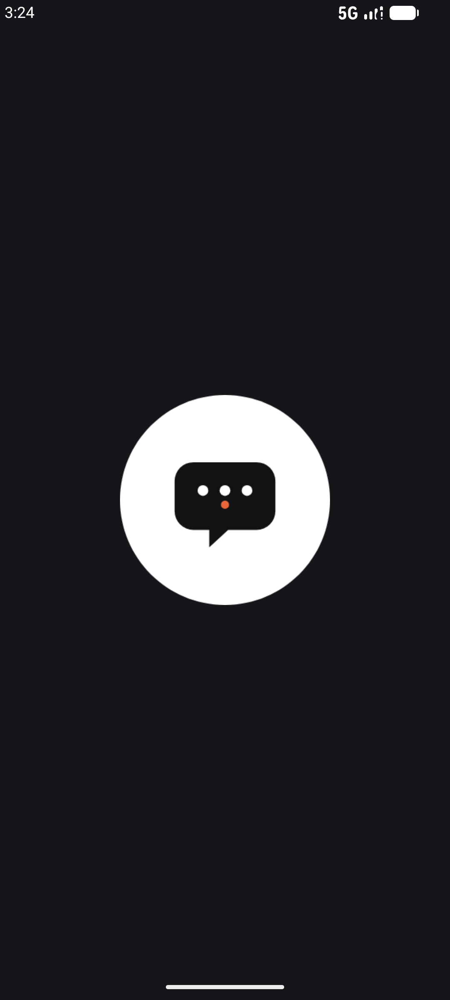</td>
    <td align="center"><b>登录引导</b><br/>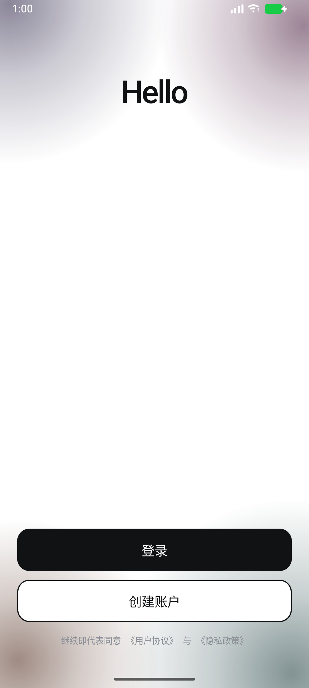</td>
    <td align="center"><b>首页 · 快捷启动</b><br/>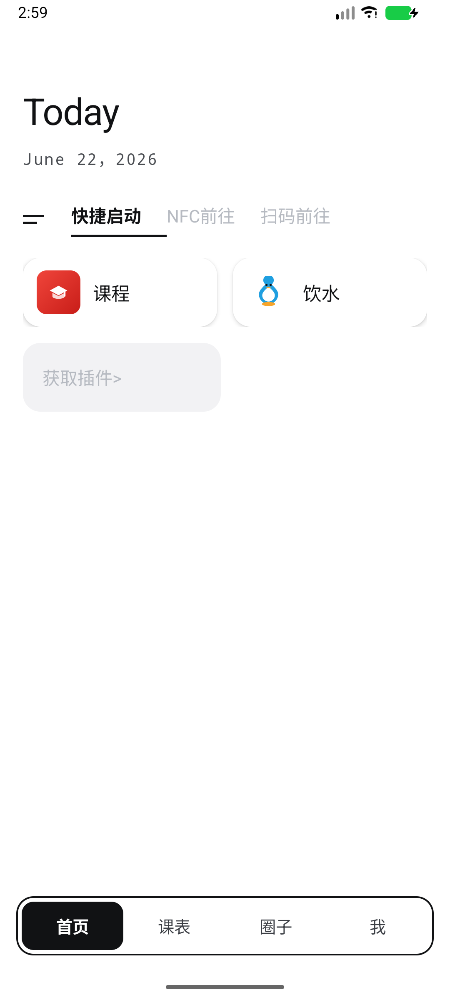</td>
  </tr>
  <tr>
    <td align="center"><b>课表</b><br/>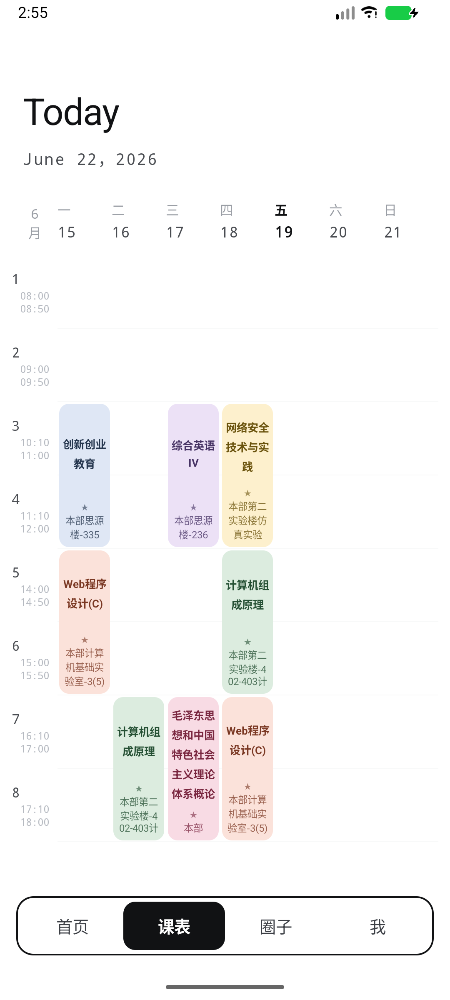</td>
    <td align="center"><b>圈子</b><br/>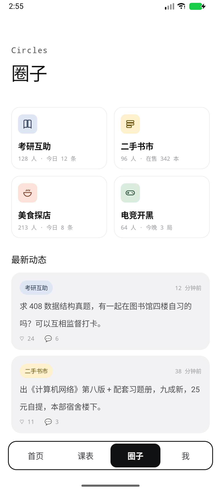</td>
    <td align="center"><b>我</b><br/>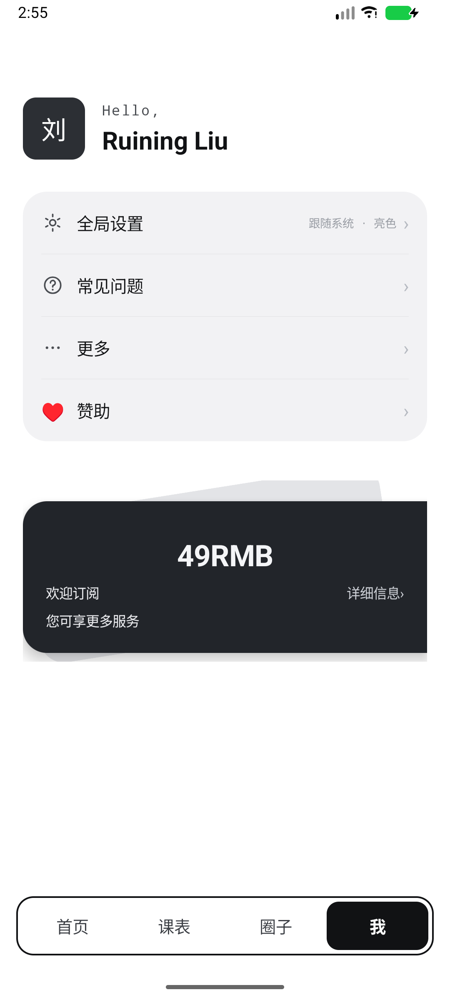</td>
  </tr>
</table>

<table>
  <tr>
    <td align="center"><b>全局设置</b><br/>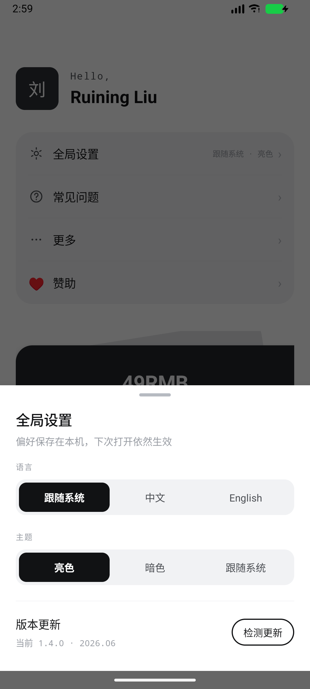</td>
    <td align="center"><b>常见问题</b><br/>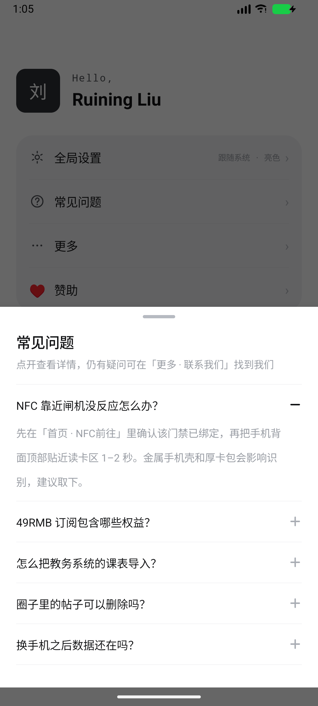</td>
    <td align="center"><b>插件管理</b><br/>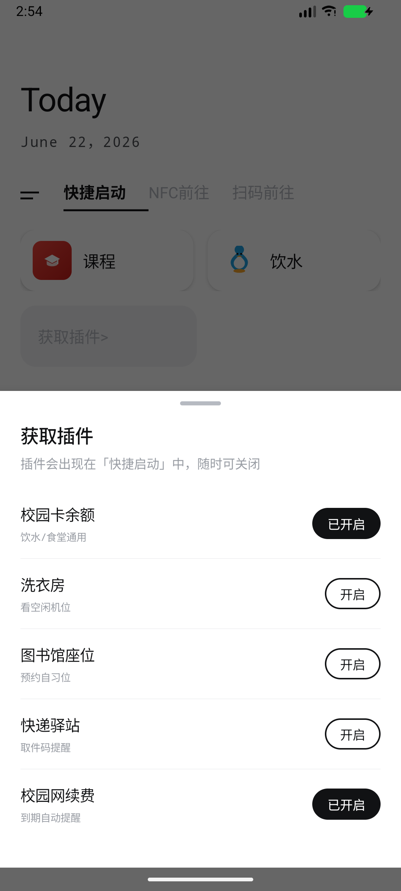</td>
  </tr>
  <tr>
    <td align="center"><b>赞助</b><br/>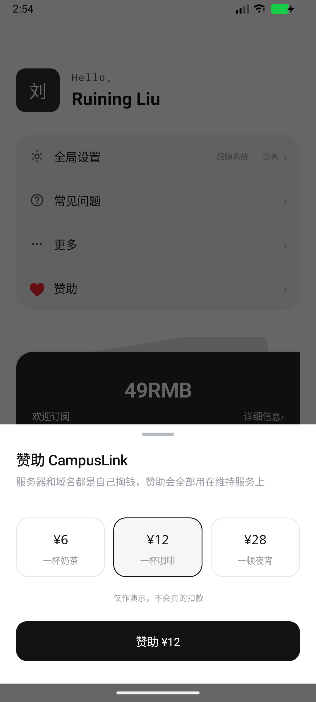</td>
    <td align="center"><b>暗色 · 首页</b><br/>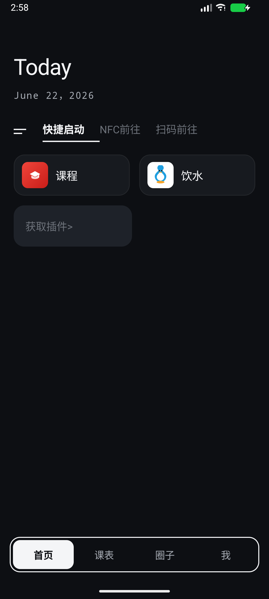</td>
    <td align="center"><b>暗色 · 登录</b><br/>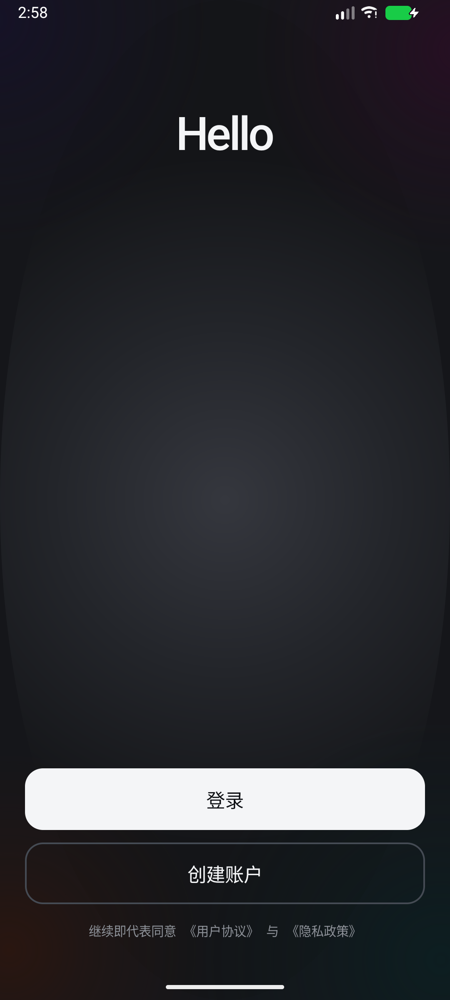</td>
  </tr>
</table>

> 以上均为 1080 × 2400 模拟器实机截图，不是设计稿。

---

## 功能清单

### 开屏与登录

- 深灰底中央一枚白色圆盘，先做一次呼吸缩放
- 白盘以自身为圆心放大铺满整屏（约 700 ms，先慢后快）
- 转场后四角浮起墨色晕染，`Hello` 先淡入、再上浮至标题位，最后浮现「登录 / 创建账户」
- 点击屏幕任意处可跳过动画直达登录页
- 登录按钮按主题反转配色（亮色墨黑实心 / 暗色浅色实心），暗色下不会「黑压黑」

### 首页

- 顶部 `Today` 标题与日期**固定不动**，只有下方「纸面」随导航左右平移
- 三个分段：快捷启动 / NFC 前往 / 扫码前往，切换时内容淡入、下划线指示器跟随
- 插件卡（课程、饮水）+「获取插件」半宽格子，点进插件管理弹层
- NFC 面板：大图标 + 三行状态信息
- 扫码面板：深色取景框 + 四角 L 形角标 + 往复扫描线 + 两条扫码历史

### 课表

- 横向 7 天 × 纵向 8 节次的周视图网格
- 左侧节次时间轴（08:00 – 21:00），今天所在列加粗
- 课程块跨两行排布，按课程配色（6 组固定色板），显示课名、星标、地点
- 网格底线由自定义 `GridRow` 绘制

### 圈子

- 2 × 2 主题卡片：考研互助 / 二手书市 / 美食探店 / 电竞开黑
- 点击卡片筛选下方动态流，选中态显示描边，再点一次取消
- 动态卡：标签、相对时间、正文、点赞与评论计数

### 我

- 头像方块 + `Hello, <昵称>`
- 菜单：全局设置（右侧实时显示当前主题与语言）、常见问题、更多（可展开：关于 / 隐私 / 联系）、赞助
- 旋转 −9° 的订阅卡：49 RMB、欢迎订阅、详细信息入口

### 弹层（8 套内容共用一层底部抽屉）

| 弹层 | 内容 |
| --- | --- |
| 全局设置 | 语言 / 主题（亮 / 暗 / 跟随系统）分段控件、版本更新检测 |
| 常见问题 | 5 条手风琴，+/− 图标切换 |
| 关于 | 品牌信息与版本号 |
| 隐私 | 个人信息收集清单 |
| 联系 | 客服邮箱，一键复制到剪贴板 |
| 赞助 | 6 / 12 / 28 三档金额选择 |
| 插件 | 5 个插件开关（课程、饮水、NFC、扫码、圈子） |
| 会员 | 权益列表 + 立即订阅 |

### 系统行为

- **主题**：亮 / 暗 / 跟随系统，写入 `SharedPreferences`，切换后 `recreate()` 立即生效
- **返回键**：先关弹层 → 再回首页 → 最后才退出，三级递进
- **状态栏**：真实系统栏 + `WindowInsets` 内边距，图标明暗随主题切换
- **Android 12+ 开屏**：`values-v31` 覆写 `windowSplashScreenAnimatedIcon`，系统闪屏与自绘开屏无缝衔接

---

## 设计系统

配色、圆角、字号全部从原型 1:1 迁移。

### 色彩

| 语义 | 亮色 | 暗色 |
| --- | --- | --- |
| 背景 `bg` | `#FFFFFF` | `#0D0F13` |
| 主文字 `ink` | `#111214` | `#F4F5F7` |
| 次级文字 `ink_2` | `#4A4D52` | `#A8ADB5` |
| 辅助文字 `ink_3` | `#9A9EA5` | `#6E747D` |
| 分隔线 `line` | `#E6E7EA` | `#262A31` |
| 卡片 `card` | `#F2F2F4` | `#171A1F` |
| 强调 `accent` | `#E8663A` | `#FF7A4D` |

另有 6 组固定色板用于课表与圈子标签：`blue / purple / sand / clay / sage / rose`，各自成对定义底色与文字色。

### 尺寸

| 项目 | 值 |
| --- | --- |
| 设计基准宽 | **392 dp**（所有值按屏宽等比缩放） |
| 页面左右留白 | 20 dp |
| 卡片圆角 | 14 / 15 / 16 / 18 / 22 dp |
| 底部抽屉圆角 | 26 dp（仅上圆角） |
| Tab 胶囊描边 | 1.6 dp |
| 卡片阴影 | elevation 2.5 dp |

### 动效曲线

统一使用 `PathInterpolator(0.22, 0.9, 0.28, 1.0)`；页面切换用 `(0.34, 0.72, 0.24, 1.0)`，时长 420 ms。

开屏时间轴（与原型对齐）：

```
0 ms      圆盘呼吸开始
790 ms    白盘放大铺满（1 → 18 倍）
1360 ms   墨色晕染浮现
1520 ms   Hello 淡入
2050 ms   Hello 上浮至顶部
2330 ms   登录 / 创建账户按钮出现
```

---

## 技术实现要点

**1. 全代码构建 UI**
没有 `setContentView(R.layout.xxx)`，`MainActivity` 里直接 new 出 `FrameLayout` / `LinearLayout` / `ScrollView`，再逐层 `addView`。好处是布局逻辑与状态强绑定、复用函数即复用样式；代价是没法用布局预览器。

**2. 等比缩放**
`Widgets.kt` 提供 `Context.sdp(v)`：以 392 dp 为基准，按 `widthPixels / (392 × density)` 换算。设计稿上的数字可以直接写进去，换到任何屏幕宽度都保持比例。

**3. 自定义 View**

| View | 职责 |
| --- | --- |
| `InkBlobs` | 四个 `RadialGradient` 色斑，按尺寸缓存 Shader，绘制时用 `Matrix` 做缓慢漂移 |
| `ScanBracket` | 四角 L 形取景标 + 往复扫描线 |
| `GridRow` | 课表横向网格底线 |

> 继承自 `LinearLayout` 一类的 ViewGroup 必须显式 `setWillNotDraw(false)`，否则 `onDraw` 不会被调用——这是本项目中踩过的一个坑。

**4. 主题切换**
`ThemePrefs` 封装 `SharedPreferences`（键 `cl-theme` / `cl-lang`），启动时 `AppCompatDelegate.setDefaultNightMode` 生效；用户在设置里改动后 `recreate()`，状态栏图标明暗通过 `WindowCompat.getInsetsController` 同步。

**5. 页面切换**
四个页面同时存在于一个 `FrameLayout` 中，切换时旧页面向左/右平移淡出、新页面自反方向进入，**标题层不动**，只有内容层（`PageShell.sheet`）参与位移——这是原型里最关键的一处手感。

**6. 底部抽屉**
`BottomSheetDialog` + 自定义 `SheetDialog` 样式（26 dp 上圆角、去掉最大宽度限制），内容由 `Sheets` 统一构建，8 套内容共用同一个容器与关闭逻辑。

---

## 项目结构

```
UniHub_UI/
├── app/
│   └── src/main/
│       ├── java/com/example/applicationoneapp/
│       │   ├── MainActivity.kt            # 主容器：四页叠加 + TabBar + 弹层 + 返回栈
│       │   ├── common/
│       │   │   ├── Pal.kt                 # 颜色取值（主题感知）
│       │   │   ├── ThemePrefs.kt          # 主题 / 语言持久化
│       │   │   └── Ui.kt                  # dp、圆角、颜色、字体等基础工具
│       │   ├── ui/
│       │   │   ├── LaunchActivity.kt      # 开屏 + 登录（含 InkBlobs 自绘）
│       │   │   ├── page/
│       │   │   │   ├── HomePage.kt        # 首页（含 ScanBracket）
│       │   │   │   ├── TimetablePage.kt   # 课表（含 GridRow）
│       │   │   │   ├── CirclesPage.kt     # 圈子
│       │   │   │   └── MePage.kt          # 我
│       │   │   ├── sheet/Sheets.kt        # 8 套底部弹层
│       │   │   └── widget/Widgets.kt      # PageShell / TabBar / Toast / 缩放适配
│       ├── res/
│       │   ├── values/                    # 亮色色板、字体、主题
│       │   ├── values-night/              # 暗色色板、主题
│       │   ├── values-v31/                # Android 12+ 系统闪屏
│       │   └── drawable/                  # 矢量图标（全部手写 path）
│       └── AndroidManifest.xml
├── design/                                # 原始 HTML 交互原型
│   ├── index.html                         # 主界面
│   └── login.html                         # 登录引导
├── screenshots/                           # 实机截图
├── gradle/libs.versions.toml              # 版本目录
└── settings.gradle.kts
```

---

## 快速开始

### 环境要求

| 项目 | 版本 |
| --- | --- |
| JDK | **25**（AGP 9.4 的 toolchain 要求，低版本会构建失败） |
| Gradle | 9.7.0（随 wrapper 提供，无需单独安装） |
| AGP | 9.4.0 |
| compileSdk / targetSdk | 37 |
| minSdk | 24（Android 7.0） |
| Android Studio | Ladybug 及以上（需支持 AGP 9.4） |

> ⚠️ 如果本机默认 JDK 是 11 或 17，请在 `Settings → Build, Execution, Deployment → Build Tools → Gradle → Gradle JDK` 里显式指定 JDK 25，否则会报 `Unable to download toolchain matching {languageVersion=25}`。

### 命令行构建

```bash
# macOS / Linux
./gradlew assembleDebug

# Windows
gradlew.bat assembleDebug
```

产物：`app/build/outputs/apk/debug/app-debug.apk`

安装到设备：

```bash
adb install -r app/build/outputs/apk/debug/app-debug.apk
```

首次启动进入开屏 → 登录页，点「登录」即进入主界面（当前为 Demo，不做真实鉴权）。

### 关于 Gradle 下载源

`gradle/wrapper/gradle-wrapper.properties` 里的 `distributionUrl` 指向阿里云镜像，国内网络更稳。若在海外，改成官方地址即可：

```properties
distributionUrl=https\://services.gradle.org/distributions/gradle-9.7.0-bin.zip
```

---

## HTML 原型

[`design/`](design/) 下是最初的交互原型，纯 HTML + CSS + 原生 JS，单文件、零依赖：

| 页面 | 文件 |
| --- | --- |
| 登录引导 | [`design/login.html`](design/login.html) |
| 主界面 | [`design/index.html`](design/index.html) |

双击即可在浏览器打开。桌面端以 392 × 844 的手机外框居中展示，窗口宽度小于 470 px 时自动全屏；支持锚点直达 `#home` / `#timetable` / `#circles` / `#me`。

原生实现与原型的差异，主要在「iOS 风格的模拟状态栏」被替换成了真实系统状态栏 + `WindowInsets`。

---

## 已知限制

- **数据全部为本地 Mock**：课程、动态、扫码历史、账号信息都写死在代码里，没有网络层与数据库
- **登录是 Demo 行为**：点按钮即进入主界面，没有账号体系
- **包名仍为占位符** `com.example.applicationoneapp`，正式发布前需重命名
- **仅中文单语种**：`lint` 中已关闭 `HardcodedText` / `SetTextI18n` / `MissingTranslation`
- **未适配横屏与平板**：布局按 392 dp 竖屏等比缩放，横屏会出现大量留白
- **无单元测试与 UI 测试**：`androidTest` 目录仅有模板文件

## Roadmap

- [ ] 接入真实课表数据（教务系统 / JSON 导入）
- [ ] 「饮水」做成可记账的消费流水页
- [ ] NFC 与扫码接入真实能力（`NfcAdapter` / CameraX）
- [ ] 圈子接入后端，支持发帖与评论
- [ ] 抽取 `strings.xml` 支持多语言
- [ ] 平板 / 折叠屏布局

---

## 许可证

本项目暂未声明开源许可证。如需商用或二次分发，请先联系作者。

<div align="center">
<sub>Designed & built by <a href="https://github.com/wanschan">wanschan</a></sub>
</div>
